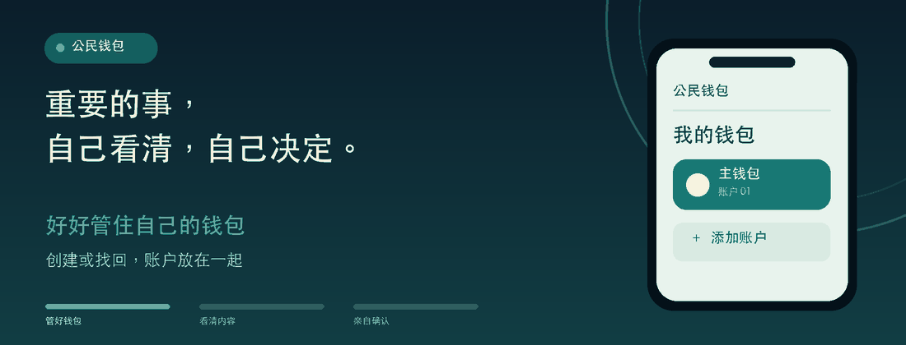

  
  <h1>公民钱包</h1>
  
自己的钱包，自己做主。

  <picture>
    
  </picture>

## 钱包在手，决定由你

公民钱包是一款让你自己掌握账户与重要决定的手机钱包。创建或找回钱包，把账户放在一起管理；需要确认交易或登录时，先看清，再决定。我们希望每个人都能安心地说“这是我自己的选择”。

## 从打开钱包到完成确认

<table>
  <tr>
    <td align="center" width="33%"><strong>🌱 管好钱包</strong> 创建新钱包，或用备份找回；多个账户放在一起，也能出示自己的账户码。</td>
    <td align="center" width="33%"><strong>👀 看清再决定</strong> 扫一扫交易或登录内容，先看懂中文说明，再决定要不要继续。</td>
    <td align="center" width="33%"><strong>👍 亲自确认</strong> 在自己的手机上点头，再向另一台设备出示结果码；钱包手机可以不联网。</td>
  </tr>
</table>

## 放心，是因为每一步都看得见

钱包手机可以不联网，双方通过二维码传递内容与结果，钱包里的秘密不必交给另一台设备。过期、无法识别或不属于这个钱包的内容会被拦下。重要信息平时藏好，遇到截屏、录屏或保护失效时会重新隐藏。

> 请妥善保管助记词，它能帮你找回钱包。

## 许可

本仓库自有代码采用 [MIT 许可证](LICENSE)；第三方代码遵循各自的许可证。
